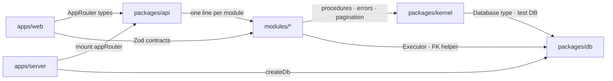

<!-- intent-skills:start -->
## Skill Loading

Before editing files for a substantial task:
- Run `pnpm dlx @tanstack/intent@latest list` from the workspace root to see available local skills.
- If a listed skill matches the task, run `pnpm dlx @tanstack/intent@latest load <package>#<skill>` before changing files.
- Use the loaded `SKILL.md` guidance while making the change.
- Monorepos: when working across packages, run the skill check from the workspace root and prefer the local skill for the package being changed.
- Multiple matches: prefer the most specific local skill for the package or concern you are changing; load additional skills only when the task spans multiple packages or concerns.
<!-- intent-skills:end -->

# Monorepo map

Package-level rules live in each app/package `AGENTS.md`. This root file is
**workspace-wide**: layout, dependency red lines, quality gates, and shared style.

**One business capability = one directory**: `modules/<domain>` holds it top to
bottom; `apps/web/src/features/<domain>` is its UI. Layers live *inside* a module.

```text
modules/<domain>    one capability (demo: authors, posts) — see modules/AGENTS.md
  src/contract.ts     Zod + types, browser-safe (the web imports this)
  src/schema.ts       Drizzle tables
  src/repo.ts         the only code that touches those tables
  src/router.ts       tRPC procedures, repo on ctx.<domain>
  test/               router tests on a temp SQLite
packages/kernel     module SDK: procedures + error mapping, context, errors, pagination, test context
packages/db         createDb, Executor, FK helper, createTestDb; drizzle config + migrations
packages/api        composition only: appRouter (one line per module) + AppRouter types
packages/ui         shared UI primitives
apps/server         HTTP host — env, createDb, mount appRouter
apps/web            SPA — features/<domain> mirrors modules/<domain>
```



**Red lines** (each is enforced by a tool, not by this text)

| Rule | Enforced by |
|------|-------------|
| Module dependencies point one way (posts → authors) | pnpm — a module resolves only modules in its `package.json` |
| A module never imports another module's `router` or `@workspace/api` | Biome (`biome.jsonc`) |
| `contract.ts` stays browser-safe; `router.ts` reaches data only via its repo | Biome |
| `apps/web` imports module contracts, `kernel/pagination`, ui, and `AppRouter` types only | Biome |
| Features reach each other only via `api.ts` / `store.ts` | Biome |

**Add a module:** copy `modules/authors` (package.json, tsconfigs, `src/`, `test/`),
add it to `packages/api` (dependency + one `appRouter` line) and, for UI,
`apps/web` (dependency + `features/<name>/` + route + nav link). Its tables are
picked up by the drizzle config and `createTestDb()` automatically.

**Quality gates:** `pnpm typecheck` · `pnpm check` / `pnpm fix` · `pnpm test` — CI (`.github/workflows/ci.yml`) runs these plus `pnpm build` and fails on a dirty tree. Commits pass `commitlint` (`.commitlintrc.yaml`, `commit-msg` hook) and PR titles pass the same Conventional Commit rules (`.github/workflows/pr-title.yml`) because the title becomes the squash commit  
**DB (demo / local iterate):** `pnpm db:push` — real migrations after product schema stabilizes

# Contract changes

The web and server deploy separately and tRPC has no versions, so during a
rolling deploy old web bundles call the new server:

- One release carries only additive changes: new procedures, new optional
  input fields, new output fields
- Deploy the server before the web
- Removing or renaming a field takes two releases: stop using it in the web,
  then remove it from the server
- Never tighten input validation in the release that ships the web change

# Code style

Biome (Ultracite preset) formats and lints everything; `pnpm fix` before
committing (lefthook also runs it). What it cannot check is on you:

- **Fail loud** — no empty `catch` or `?? default` hiding a failure; propagate,
  or log the root cause (`rootCause` from `@workspace/kernel/errors`)
- **Honest names** — `PostDialog` handles create *and* edit, so it is not
  `CreatePostDialog`
- **Comments** only for what code can't say: a non-obvious decision, a
  workaround and its reason, an invariant
- **Business rules** live in module repos and routers — never in the host or the web
- **Accessibility** — every dialog has a title, icon buttons have labels,
  forms use the `Field` primitives

# Testing

- Vitest runs each package's `test/` (`*.test.ts`; `*.test.tsx` in
  `apps/web`); import `describe` / `it` / `expect` from `vitest` (no globals)
- Testing Trophy: integration first — module routers via `createTestContext()`,
  the host via `app.request()`, web pages via `renderApp()` with MSW `trpc()`.
  Unit tests for pure logic; E2E only for critical flows
- Tests use a temp SQLite (`createTestDb()` / `createTestContext()`), never
  `local.db` or a remote DB
- Mock only at the network or process boundary — never a workspace package
- A bug fix starts with a test that fails; new behavior ships with tests
- Never weaken or delete an assertion, or add `.only` / `.skip`, to get green
- Demo code ships with its tests (the reference pattern) and is deleted with
  them (`docs/REMOVE-DEMO.md`)
- `pnpm test` runs everything (Turbo caches unchanged packages);
  `pnpm exec vitest related <files> --run` inside a package runs only the
  tests that import your change
- `pnpm e2e` builds and runs Playwright (`apps/web/e2e/*.e2e.ts`) against real
  processes it starts itself — a fresh temp database, `apps/server` and `vite
  preview` — so no dev server may be left running. Once per machine, install
  its browser: `pnpm --filter web exec playwright install chromium`
- Keep suites flat; assert inside `it()`; async/await, no done callbacks

Why things are the way they are: `docs/DECISIONS.md`.
