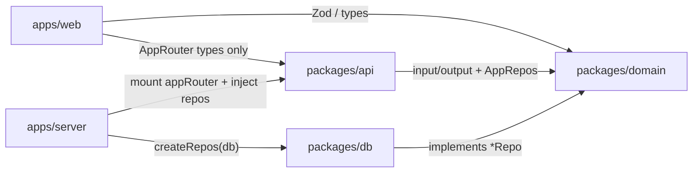

<!-- intent-skills:start -->
## Skill Loading

Before editing files for a substantial task:
- Run `pnpm dlx @tanstack/intent@latest list` from the workspace root to see available local skills.
- If a listed skill matches the task, run `pnpm dlx @tanstack/intent@latest load <package>#<skill>` before changing files.
- Use the loaded `SKILL.md` guidance while making the change.
- Monorepos: when working across packages, run the skill check from the workspace root and prefer the local skill for the package being changed.
- Multiple matches: prefer the most specific local skill for the package or concern you are changing; load additional skills only when the task spans multiple packages or concerns.
<!-- intent-skills:end -->

# Monorepo map

Package-level rules live in each app/package `AGENTS.md`. This root file is
**workspace-wide**: layout, dependency red lines, quality gates, and shared style.

```text
apps/web          SPA — features, routes, tRPC client
apps/server       HTTP host — env, createDb, inject repos, mount tRPC
packages/domain   Contracts — Zod, types, *Repo / AppRepos (no SQL)
packages/api      tRPC routers + context (thin; uses ctx.repos)
packages/db       Drizzle schema, repo implementations, createDb
packages/ui       Shared UI primitives
```



**Red lines**

- `apps/web` must not import `@workspace/db` or value-import `@workspace/api` root
- `packages/api` uses `ctx.repos` only — no raw `db` on context
- Shapes live in `@workspace/domain`; SQL lives in `@workspace/db`
- Prefer the nearest package `AGENTS.md` when editing that package

**Quality gates:** `pnpm typecheck` · `pnpm check` / `pnpm fix` · `pnpm test`  
**DB (demo / local iterate):** `pnpm db:push` — real migrations after product schema stabilizes

# Ultracite Code Standards

This project uses **Ultracite**, a zero-config preset that enforces strict code quality standards through automated formatting and linting.

## Quick Reference

- **Format code**: `pnpm dlx ultracite fix`
- **Check for issues**: `pnpm dlx ultracite check`
- **Diagnose setup**: `pnpm dlx ultracite doctor`

Biome (the underlying engine) provides robust linting and formatting. Most issues are automatically fixable.

---

## Core Principles

Write code that is **accessible, performant, type-safe, and maintainable**. Focus on clarity and explicit intent over brevity.

### Type Safety & Explicitness

- Use explicit types for function parameters and return values when they enhance clarity
- Prefer `unknown` over `any` when the type is genuinely unknown
- Use const assertions (`as const`) for immutable values and literal types
- Leverage TypeScript's type narrowing instead of type assertions
- Use meaningful variable names instead of magic numbers - extract constants with descriptive names

### Modern JavaScript/TypeScript

- Use arrow functions for callbacks and short functions
- Prefer `for...of` loops over `.forEach()` and indexed `for` loops
- Use optional chaining (`?.`) and nullish coalescing (`??`) for safer property access
- Prefer template literals over string concatenation
- Use destructuring for object and array assignments
- Use `const` by default, `let` only when reassignment is needed, never `var`

### Async & Promises

- Always `await` promises in async functions - don't forget to use the return value
- Use `async/await` syntax instead of promise chains for better readability
- Handle errors appropriately in async code with try-catch blocks
- Don't use async functions as Promise executors

### React & JSX

- Use function components over class components
- Call hooks at the top level only, never conditionally
- Specify all dependencies in hook dependency arrays correctly
- Use the `key` prop for elements in iterables (prefer unique IDs over array indices)
- Nest children between opening and closing tags instead of passing as props
- Don't define components inside other components
- Use semantic HTML and ARIA attributes for accessibility:
  - Provide meaningful alt text for images
  - Use proper heading hierarchy
  - Add labels for form inputs
  - Include keyboard event handlers alongside mouse events
  - Use semantic elements (`<button>`, `<nav>`, etc.) instead of divs with roles

### Error Handling & Debugging

- Remove `console.log`, `debugger`, and `alert` statements from production code
- Throw `Error` objects with descriptive messages, not strings or other values
- Use `try-catch` blocks meaningfully - don't catch errors just to rethrow them
- Prefer early returns over nested conditionals for error cases

### Code Organization

- Keep functions focused and under reasonable cognitive complexity limits
- Extract complex conditions into well-named boolean variables
- Use early returns to reduce nesting
- Prefer simple conditionals over nested ternary operators
- Group related code together and separate concerns

### Security

- Add `rel="noopener"` when using `target="_blank"` on links
- Avoid `dangerouslySetInnerHTML` unless absolutely necessary
- Don't use `eval()` or assign directly to `document.cookie`
- Validate and sanitize user input

### Performance

- Avoid spread syntax in accumulators within loops
- Use top-level regex literals instead of creating them in loops
- Prefer specific imports over namespace imports
- Avoid barrel files (index files that re-export everything)
- Use proper image components (e.g., Next.js `<Image>`) over `` tags

### Framework-Specific Guidance

**Next.js:**
- Use Next.js `<Image>` component for images
- Use `next/head` or App Router metadata API for head elements
- Use Server Components for async data fetching instead of async Client Components

**React 19+:**
- Use ref as a prop instead of `React.forwardRef`

**Solid/Svelte/Vue/Qwik:**
- Use `class` and `for` attributes (not `className` or `htmlFor`)

---

## Testing

- Vitest is the shared test runner for `apps/web`, `apps/server`, `packages/api`, and `packages/db`
- Test files live under each package's `test/` directory and use `*.test.ts` (`*.test.tsx` in `apps/web`)
- Web tests render real components in jsdom and mock only the network: MSW with the `trpc()` helper in `apps/web/test/msw.ts`
- Demo code ships with its tests: they are the reference pattern for new tests and are deleted together with the demo (`docs/REMOVE-DEMO.md`)
- Integration tests get a database from `createTestDb()` (`@workspace/db/testing`): a fresh temp SQLite per test with the current schema — never `local.db` or a remote DB
- New product behavior and bug fixes must add committed tests; do not use the empty scaffold as a reason to skip coverage
- Follow the Testing Trophy: prefer integration tests, add unit tests for pure logic, and defer E2E until a real user flow exists
- Import `describe`, `expect`, `it`, and other APIs explicitly from `vitest`; do not enable globals
- Use `pnpm test` for a single run and `pnpm test:watch` during development
- Temporary scaffold-verification tests must be deleted after validation; tests for real behavior must remain committed
- Write assertions inside `it()` or `test()` blocks
- Avoid done callbacks in async tests - use async/await instead
- Don't use `.only` or `.skip` in committed code
- Keep test suites reasonably flat - avoid excessive `describe` nesting

## When Biome Can't Help

Biome's linter will catch most issues automatically. Focus your attention on:

1. **Business logic correctness** - Biome can't validate your algorithms
2. **Meaningful naming** - Use descriptive names for functions, variables, and types
3. **Architecture decisions** - Component structure, data flow, and API design
4. **Edge cases** - Handle boundary conditions and error states
5. **User experience** - Accessibility, performance, and usability considerations
6. **Documentation** - Add comments for complex logic, but prefer self-documenting code

---

Most formatting and common issues are automatically fixed by Biome. Run `pnpm dlx ultracite fix` before committing to ensure compliance.
