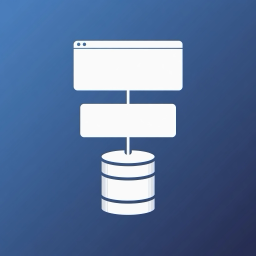

<div align="center">
<p>
  
</p>

<h1>ts-fullstack-template</h1>

<p>
  TypeScript full-stack monorepo (React, tRPC, Drizzle) shaped for AI agents.<br>
  One capability per directory, tool-enforced boundaries, tests as the gate.
</p>

<p>
  <a href="https://github.com/chengzi-io/ts-fullstack-template/actions/workflows/ci.yml"></a>
  <a href="https://github.com/chengzi-io/ts-fullstack-template/releases"></a>
  <a href="LICENSE"></a>
  
  
</p>

<!-- template-only -->
<p>
  <a href="https://github.com/chengzi-io/ts-fullstack-template/generate"></a>
</p>

<!-- /template-only -->
<p>
  
</p>
</div>

## Overview

Built so multiple AI agents and developers can work in parallel with minimal conflicts, backed by automated checks instead of review alone:

- **One capability per directory:** `modules/<domain>` holds contract, schema, repo, router, and tests; `apps/web/src/features/<domain>` holds its UI.
- **Tool-enforced boundaries:** pnpm resolves only declared module dependencies; Oxlint blocks cross-module, server-only, and cross-feature leaks; `@shadcn/lint` guards design-system tokens and primitives.
- **Contracts first:** shared Zod contracts type the web before backend work lands, and MSW mocks tRPC in tests so frontend and backend move in parallel.
- **Tests as the gate:** router tests on temp SQLite, server host tests via `app.request()`, web page tests with MSW, and one Playwright E2E test. CI also fails on a dirty working tree.
- **Local rules next to code:** every app, package, and `modules/` has its own `AGENTS.md`.

| Layer | Stack |
| --- | --- |
| Web | React 19, Vite, TanStack Router + Query, Zustand, React Hook Form, Tailwind CSS, Base UI (shadcn) |
| API | Hono, tRPC 11, Zod 4 contracts shared with web |
| Data | Drizzle ORM, libSQL (local SQLite file or Turso) |
| Quality | TypeScript, Oxlint + Oxfmt (Ultracite, `@shadcn/lint`), Vitest, MSW, Playwright |
| Observability | pino logs with redaction, end-to-end request ids, opt-in OpenTelemetry tracing |
| Repository | pnpm workspaces, Turborepo, lefthook, commitlint, git-cliff, Dependabot |

Full tool inventory: [docs/STACK.md](docs/STACK.md).

## Quick start

Requires Node 24 (`.nvmrc`), pnpm via corepack, and a POSIX shell (macOS, Linux, or WSL).

```bash
corepack enable
pnpm install
pnpm setup:local   # creates .env files from .env.example, then runs db:push
pnpm dev
```

`pnpm setup:local` never overwrites existing `.env` files and is safe to re-run. Manual equivalent: copy `packages/db/.env.example` and `apps/server/.env.example` to `.env`, then run `pnpm db:push`.

Open <http://localhost:5173> and try `/authors`, then `/posts`. Vite proxies `/trpc` to `apps/server` on port 3000.

<!-- template-only -->

## Start a project from this template

1. Click **Use this template**, create your repository, and clone it.
2. Initialize project metadata (renames the package, updates LICENSE and links, then deletes itself):

   ```bash
   node scripts/init-project.mjs
   ```

   Review the diff, commit with the printed message, and push.

3. Configure GitHub settings once as a repository admin (see [Maintainer setup](CONTRIBUTING.md#maintainer-setup)):

   ```bash
   scripts/github/setup-repo.sh   # squash-only, protected main, security
   ```

4. Copy `modules/authors` to add your first module (see [AGENTS.md](AGENTS.md)), then follow [docs/REMOVE-DEMO.md](docs/REMOVE-DEMO.md) to delete the demo.

<!-- /template-only -->

## Workspace layout

| Path | Role |
| --- | --- |
| `modules/<domain>` | Capability top to bottom: contract (Zod), schema, repo, router, tests |
| `apps/web` | SPA: `features/<domain>` mirrors `modules/<domain>`, routes, tRPC client |
| `apps/server` | HTTP host: env, `createDb`, mounts `appRouter` |
| `packages/api` | Composition: `appRouter` (one line per module) |
| `packages/kernel` | Module SDK: procedures, error mapping, context, pagination, test context |
| `packages/db` | `createDb`, `Executor`, test database, drizzle config and migrations |
| `packages/ui` | Design system primitives |

**Data flow:** `web → tRPC (contract .input/.output) → module router → module repo → Drizzle`.

## Scripts

| Command | Purpose |
| --- | --- |
| `pnpm dev` | Run all apps in watch mode |
| `pnpm check` / `pnpm fix` | Lint and format (Oxlint + Oxfmt) |
| `pnpm typecheck` | Type-check the workspace |
| `pnpm test` | Unit and integration tests |
| `pnpm e2e` | Build and run Playwright against real processes (first time: `pnpm --filter web exec playwright install chromium`) |
| `pnpm build` | Production build |
| `pnpm db:push` | Push schema directly during iteration |
| `pnpm db:generate` / `pnpm db:migrate` | Generate and apply migrations once schema stabilizes |

## Disposable demo

**Authors + posts** (foreign key, joined list, create/edit forms) verify the stack out of the box. It uses `db:push` only; do not commit demo migrations. Remove it using [docs/REMOVE-DEMO.md](docs/REMOVE-DEMO.md).

## Docs

- [AGENTS.md](AGENTS.md) and per-package `AGENTS.md` — boundaries and rules for humans and agents
- [docs/DECISIONS.md](docs/DECISIONS.md) — architecture decisions and open items
- [docs/STACK.md](docs/STACK.md) — tools, roles, and locations
- [apps/server/README.md](apps/server/README.md) — production build, env, probes, shutdown

## Contributing

1. Branch off `main`: `feat/…`, `fix/…`, or `chore/…`
2. Write [Conventional Commits](https://www.conventionalcommits.org/) (enforced by `commit-msg` hook)
3. Open a pull request; CI runs `check`, `typecheck`, `test`, `build`, and `e2e`

Details on setup, gates, and releases: [CONTRIBUTING.md](CONTRIBUTING.md). Security reports: [SECURITY.md](.github/SECURITY.md).

## License

MIT — see [LICENSE](LICENSE).
