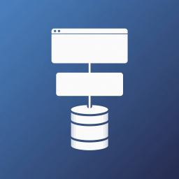

<div align="center">
<p>
  
</p>

<h1>ts-fullstack-template</h1>

<p>
  A TypeScript full-stack monorepo — React, tRPC, Drizzle — shaped for AI agents.<br>
  One capability per directory, boundaries enforced by tools, tests as the gate.
</p>

<p>
  <a href="https://github.com/chengzi-io/ts-fullstack-template/actions/workflows/ci.yml"></a>
  <a href="https://github.com/chengzi-io/ts-fullstack-template/releases"></a>
  <a href="LICENSE"></a>
  
  
</p>

<!-- template-only -->
<p>
  <a href="https://github.com/chengzi-io/ts-fullstack-template/generate"></a>
</p>

<!-- /template-only -->
<p>
  
</p>
</div>

## What this is and why it exists

AI agents write most of the code here, often several at once. The repository is
built so they can work in parallel without stepping on each other, and so their
work is checked by tools rather than by review alone:

- **One capability, one directory.** `modules/<domain>` holds a capability top to
  bottom — contract, schema, repo, router, tests — and
  `apps/web/src/features/<domain>` is its UI.
- **Boundaries enforced by tools.** pnpm resolves only the modules a package
  declares; Biome rules block cross-module, server-only, and cross-feature
  imports.
- **Contracts first.** Zod contracts give the web its types before the server
  exists, and MSW answers tRPC in tests, so front end and back end are built in
  parallel.
- **Tests as the gate.** Router tests on a temp SQLite, host tests through
  `app.request()`, page tests with MSW, one Playwright E2E; CI also fails on a
  dirty working tree.
- **Rules next to the code.** Every app and package, and `modules/` as a
  whole, has an `AGENTS.md`.

| Layer | Stack |
|-------|-------|
| Web | React 19, Vite, TanStack Router + Query, Zustand, React Hook Form, Tailwind CSS, Base UI (shadcn) |
| API | Hono, tRPC 11, Zod 4 contracts shared with the web |
| Data | Drizzle ORM, libSQL (local SQLite file or Turso) |
| Quality | TypeScript, Biome (Ultracite), Vitest, MSW, Playwright |
| Observability | pino logs with redaction, request ids end to end, opt-in OpenTelemetry tracing |
| Repository | pnpm workspaces, Turborepo, lefthook, commitlint, release-please, Dependabot |

## Quick start

Needs Node 24 (`.nvmrc`), pnpm through corepack, and a POSIX shell (macOS,
Linux, or WSL on Windows).

```bash
corepack enable
pnpm install
cp packages/db/.env.example packages/db/.env   # DATABASE_URL=file:../../local.db
pnpm db:push
pnpm dev
```

Open <http://localhost:5173> and try `/authors`, then `/posts`. The API
(`apps/server`, port 3000) sits behind Vite's proxy at `/trpc`.

<!-- template-only -->
## Start a project from this template

1. Click **Use this template**, create your repository, and clone it.
2. Make it yours. The script names the package after your repository, resets
   the version and changelog, points LICENSE, CODEOWNERS and links at your
   repository, then deletes itself:

   ```bash
   node scripts/init-project.mjs
   ```

   Review the diff, commit it with the message the script prints, and push.
3. Set up GitHub once, as a repository admin — see
   [Maintainer setup](CONTRIBUTING.md#maintainer-setup):

   ```bash
   node scripts/github/create-release-app.mjs   # the App release-please runs as
   scripts/github/setup-repo.sh                 # squash-only, protected main, security
   ```

4. Add your first module by copying `modules/authors` (see
   [AGENTS.md](AGENTS.md)), and remove the demo with
   [docs/REMOVE-DEMO.md](docs/REMOVE-DEMO.md) when it has served its purpose.

<!-- /template-only -->
## Usage

### Layout

| Path | Role |
|------|------|
| `modules/<domain>` | A capability top to bottom: contract (Zod) · schema · repo · router · tests |
| `apps/web` | SPA — `features/<domain>` mirrors `modules/<domain>`; routes; tRPC client |
| `apps/server` | HTTP host — env, `createDb`, mounts `appRouter` |
| `packages/api` | Composition — `appRouter`, one line per module |
| `packages/kernel` | Module SDK — procedures, error mapping, context, pagination, test context |
| `packages/db` | `createDb`, `Executor`, test database, drizzle config and migrations |
| `packages/ui` | Design system |

**Data path:** `web → tRPC (contract .input/.output) → module router → module repo → Drizzle`.

### Scripts

| Command | Purpose |
|---------|---------|
| `pnpm dev` | Run every app |
| `pnpm check` / `pnpm fix` | Lint and format (Biome) |
| `pnpm typecheck` | Type-check the workspace |
| `pnpm test` | Unit and integration tests |
| `pnpm e2e` | Build, then run Playwright against real processes (once per machine: `pnpm --filter web exec playwright install chromium`) |
| `pnpm build` | Production build |
| `pnpm db:push` | Sync the schema while it is still changing |
| `pnpm db:generate` / `pnpm db:migrate` | Migrations, once the schema stabilizes |

### Disposable demo

**Authors + posts** (a foreign key, a join on list, create and edit forms) make
the stack runnable out of the box. It uses `db:push` only — do not commit demo
migrations. Remove it with [docs/REMOVE-DEMO.md](docs/REMOVE-DEMO.md).

### Docs

- [AGENTS.md](AGENTS.md) and each package's `AGENTS.md` — boundaries and rules for humans and agents
- [docs/DECISIONS.md](docs/DECISIONS.md) — why it is shaped this way, and what is still open
- [apps/server/README.md](apps/server/README.md) — production build, env, probes, shutdown

## Contributing

1. Create a branch off `main`: `feat/…`, `fix/…`, or `chore/…`
2. Commit with [Conventional Commits](https://www.conventionalcommits.org/) — a hook checks each message
3. Open a pull request; CI runs `check`, `typecheck`, `test`, `build`, and the E2E test

Setup, quality gates, and release flow: [CONTRIBUTING.md](CONTRIBUTING.md).
Report vulnerabilities privately: [SECURITY.md](.github/SECURITY.md).

## License

Licensed under MIT — see [LICENSE](LICENSE).
