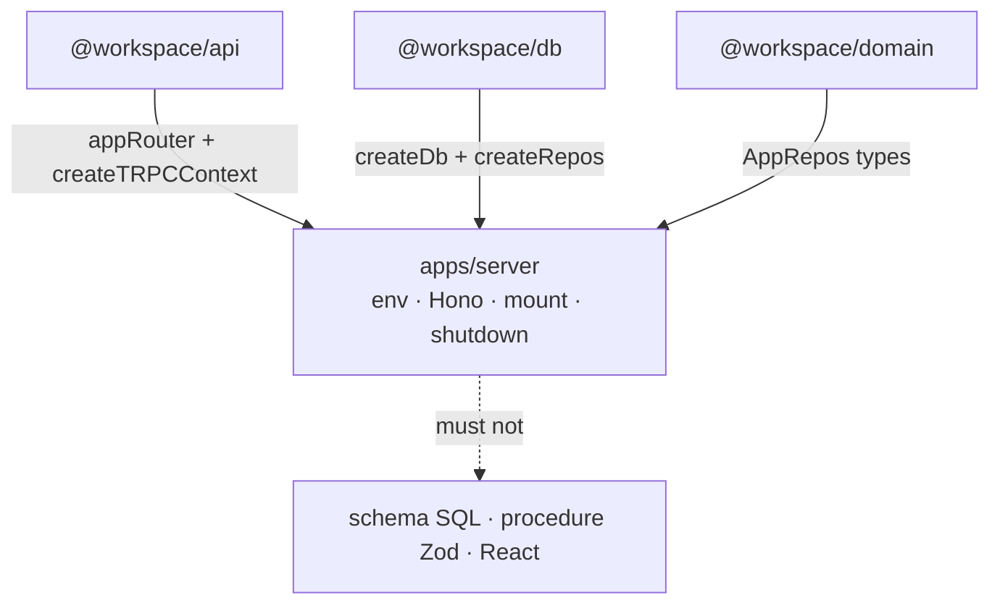

# server

Thin **HTTP host**: env, process lifecycle, Hono middleware, mount tRPC.
No domain routers, no Drizzle schema, no React.

Workspace map: root `AGENTS.md`. Routers: `@workspace/api`. Data: `@workspace/db`.

## Responsibility

| Owns | Does not own |
|------|----------------|
| `createEnv` (t3-env) + boot wiring | Zod domain shapes / `*Repo` impl |
| `createApp` middleware + probes | tRPC procedure logic |
| pino logger, access log, graceful shutdown | Browser / Vite |
| Load `packages/db/.env` for `DATABASE_*` | Own kit migrations |

## Constraints

- Composition root (`src/index.ts`): env → `createDb` → `createRepos` → `createApp` → listen
- tRPC context: `{ log, repos, requestId, session? }` — **no raw `db`**
- Keep `db` on the host only for `ping` / `close` and probes
- Do **not** import `drizzle-orm` or implement repositories here
- `DATABASE_*` live in `packages/db/.env` (or platform), **not** `apps/server/.env`
- Scripts: `--env-file-if-exists=../../packages/db/.env --env-file-if-exists=.env`
- Never log `DATABASE_AUTH_TOKEN`
- Build: `tsup` bundles `@workspace/*`; keep `@libsql/client` external

## This package’s edge



| Concern | Where |
|---------|--------|
| Procedures | `@workspace/api` |
| Tables / repos | `@workspace/db` |
| Wire Zod | `@workspace/domain` |
| HTTP host | this app |

## Layout

```text
src/
  index.ts              composition root + signals
  app.ts                Hono app factory
  env.ts                t3-env + Zod
  lib/logger.ts         pino
  lib/shutdown.ts       idempotent HTTP → DB close
  middleware/access-log.ts
  routes/probes.ts      /healthz · /readyz
tsup.config.ts
scripts/smoke-build.mjs
```

## Middleware order

`requestId` → log child + `X-Request-Id` → access log (skip probes) → `secureHeaders` → `bodyLimit` → optional CORS on `/trpc/*` → routes → `notFound` / `onError`

## Endpoints

| Path | Role |
|------|------|
| `GET /healthz` | Liveness |
| `GET /readyz` | Readiness (`db.ping()` → 503 if down) |
| `/trpc/*` | `appRouter` |
| `GET /` | ok text |

## Env

| Var | Owner file | Notes |
|-----|------------|--------|
| `DATABASE_URL` | `packages/db/.env` | required |
| `DATABASE_AUTH_TOKEN` | `packages/db/.env` | remote only |
| `PORT`, `CORS_ORIGIN`, `LOG_LEVEL`, timeouts | `apps/server/.env` | optional defaults |

## Testing

- Prefer `createApp(...)` + `app.request()` — no real listen port
- Inject silent logger, isolated temp DB, explicit CORS
- Shutdown tests inject server/DB/exit/timers — never real `process.exit` in unit tests
- Do not use developer `.env` or `local.db`
- `pnpm --filter server test` includes build smoke (`GET /healthz` on `dist`)

## Commands

```bash
pnpm --filter server dev
pnpm --filter server build && pnpm --filter server start
pnpm --filter server typecheck
pnpm --filter server test
```
