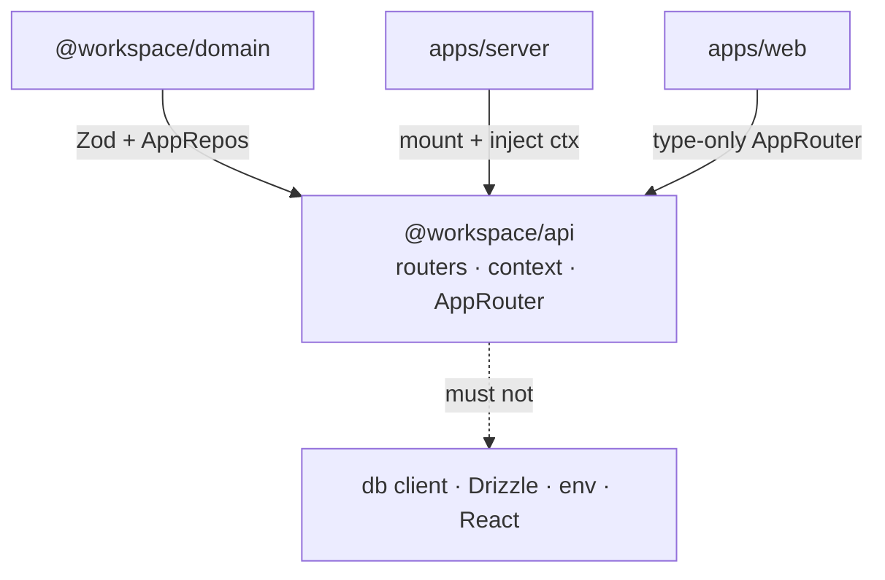

# @workspace/api

tRPC **routers** + **context**. Thin: domain Zod on the wire, data via `ctx.repos`.
No env, no raw Drizzle, no React.

Workspace map: root `AGENTS.md`. Shapes / ports: `@workspace/domain`. SQL: `@workspace/db`.

## Responsibility

| Owns | Does not own |
|------|----------------|
| `appRouter`, procedure paths | Zod field lists (→ domain) |
| `createTRPCContext`, procedures | Repo SQL (→ db) |
| `AppRouter` / `RouterInputs` / `RouterOutputs` | HTTP host (→ `apps/server`) |

## Constraints

- Routers call **`ctx.repos` only** — never put `db` on context
- `.input()` / `.output()` from `@workspace/domain/*` — do not redefine shapes here
- Method names match repos (`list`, `byId`, `create`, …)
- Map repo `null` / `false` → `TRPCError`
- Prefer `satisfies TRPCRouterRecord`
- **No** `process.env`, Hono, or React in this package
- Demo routers `authors` / `posts` are disposable
- Exports: `.` (router + types), `./context` only

## This package’s edge



| Who | How |
|-----|-----|
| `apps/server` | `appRouter` + `createTRPCContext({ log, repos, requestId, session? })` |
| `apps/web` | `import type { AppRouter, RouterInputs, RouterOutputs }` — never value-import root/context/routers |
| Domain / forms | Value-import Zod from `@workspace/domain/*` |

## Layout

```text
src/
  index.ts           appRouter, types, createCaller
  trpc.ts            initTRPC, public/protectedProcedure
  context.ts         createTRPCContext
  router/
    authors.ts       demo
    posts.ts         demo
```

## Add a domain router

1. Zod + `*Repo` in `@workspace/domain`
2. Implement repo in `@workspace/db`, register `createRepos`
3. `src/router/<name>.ts` — thin procedures
4. Mount on `appRouter` in `index.ts`

## Usage

```ts
// host
import { appRouter } from "@workspace/api";
import { createTRPCContext } from "@workspace/api/context";

// browser (types only)
import type { AppRouter, RouterInputs, RouterOutputs } from "@workspace/api";
```

```bash
pnpm --filter @workspace/api typecheck
# tests: createCaller + real or fake repos
```
