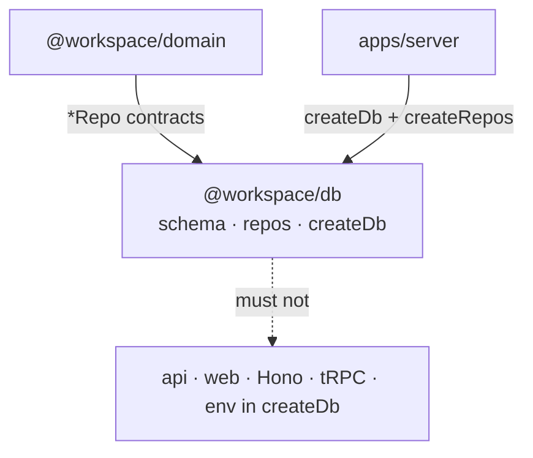

# @workspace/db

Data layer: Drizzle **schema**, **repo implementations**, **`createDb`**, and kit migrations.
No Hono / tRPC / React. No `process.env` inside `createDb`.

Workspace map: root `AGENTS.md`. Contracts (`*Repo`, Zod): `@workspace/domain`.

## Responsibility

| Owns | Does not own |
|------|----------------|
| Tables under `src/schema/` | Wire Zod / tRPC routers |
| `createXxxRepo` + `createRepos` | HTTP env (`PORT`, CORS, …) |
| `createDb` → `ping` / `close` | Import-time DB singleton |
| Kit `.env` `DATABASE_*` only | App-wide secrets |

## Constraints

- **Do** implement `@workspace/domain` `*Repo`; method names match tRPC
- **Do** pass config into `createDb({ url, authToken? })` from the host
- Relative `file:` paths use **process.cwd()**; template `.env` uses `file:../../local.db` so kit (`packages/db`) and server (`apps/server`) share monorepo-root `local.db`
- **Do not** read `process.env` in runtime client code (kit may; `createDb` must not)
- **Do not** depend on `@workspace/api`, Hono, React
- **Do not** let `apps/web` import this package
- **Do not** add `src/schema/index.ts` barrels — use `@workspace/db/schema/<name>`
- Demo `authors` / `posts` are disposable; template keeps `drizzle/` empty (use `db:push`)

## This package’s edge



| Who | How |
|-----|-----|
| `apps/server` | `createDb` → `createRepos` → inject `repos`; `ping` / `close` on host |
| `packages/api` | Only via `ctx.repos` (never import db client in routers) |
| `packages/domain` | Ports this package implements |
| `apps/web` | Never |

## Public surface

| Import | File |
|--------|------|
| `@workspace/db` | `src/index.ts` — `createDb`, `Database` |
| `@workspace/db/repos` | `src/repos/index.ts` — `createRepos` |
| `@workspace/db/schema/<name>` | `src/schema/<name>.ts` |

```ts
import { createDb } from "@workspace/db";
import { createRepos } from "@workspace/db/repos";

const db = createDb({ url: env.DATABASE_URL, authToken: env.DATABASE_AUTH_TOKEN });
const repos = createRepos(db);
await db.ping();
db.close();
```

Hosts should not import `drizzle-orm` for readiness — use `db.ping()` / `db.close()`.

## Layout

```text
src/
  index.ts           createDb + Database
  repos/
    index.ts         createRepos → AppRepos
    authors.ts       demo
    posts.ts         demo (join author)
  schema/
    authors.ts       demo
    posts.ts         demo FK → authors
drizzle/             empty in template; real migrations later
drizzle.config.ts    kit (requires DATABASE_URL)
.env.example         DATABASE_URL / DATABASE_AUTH_TOKEN
```

## Schema & repos

- One domain (or tight set) per `schema/<name>.ts`
- Column order: keys → fields → timestamps (not alphabetical)
- Repos map rows to **domain** shapes (`toPaginatedResult`, joins for nested author)
- Prefer `$inferInsert` / `$inferSelect` **inside** repos; do not export row types as a second public API next to domain Zod

### Add a table

1. `src/schema/<name>.ts` + `src/repos/<name>.ts`
2. Register in `repos/index.ts` + domain `AppRepos`
3. Iterate with `pnpm db:push`
4. When stable: `pnpm db:generate` → commit `drizzle/**` → `pnpm db:migrate`

## Migrations

| Phase | Command | Commit `drizzle/`? |
|-------|---------|--------------------|
| Local / shape still moving | `pnpm db:push` | No |
| Shape stable (team / CI / prod) | `pnpm db:generate` → migrate | Yes |
| Clone with migrations | `pnpm db:migrate` only | Apply existing |

Demo schema: **push only** — do not commit demo migrations.

## Env (kit vs runtime)

- Kit: this package `.env` (`cp .env.example .env`); scripts use `--env-file-if-exists=.env`
- `DATABASE_URL` required for kit (see `drizzle.config.ts`)
- Runtime: host validates env, then `createDb({ url, authToken? })`
- Never commit secrets or `*.db`

## Testing

- Temp SQLite file per suite; schema via push, not written migrations
- Cleanup: `close` + delete `.db` / `-wal` / `-shm` (including failure paths)
- Do not hit developer `local.db` or remote DBs

## Commands

```bash
pnpm db:push | db:generate | db:migrate | db:studio | db:check
pnpm --filter @workspace/db typecheck
pnpm --filter @workspace/db test
```
