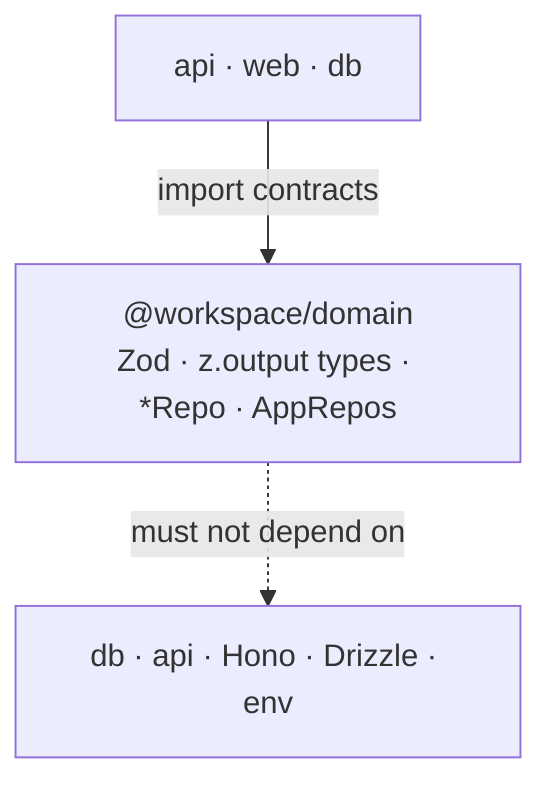

# @workspace/domain

Shared **contracts** only: Zod shapes, derived types, and `*Repo` / `AppRepos` ports.
No SQL, no tRPC runtime, no env.

Workspace layout and cross-app wiring: root `AGENTS.md`.

## Responsibility

| Owns | Does not own |
|------|----------------|
| Wire / form validation (Zod) | Drizzle schema, queries |
| `type X = z.output<typeof schema>` | tRPC routers |
| `PostsRepo`, `AppRepos`, … | HTTP host / React |

## Constraints

- **No** imports of `@workspace/db`, `@workspace/api`, Hono, Drizzle, libsql
- Field lists live **once** in Zod; use `pick` / `partial` / `extend` for inputs
- Repo method names match tRPC (`list`, `byId`, `create`, …)
- Demo modules (`authors`, `posts`) are disposable

## This package’s edge



| Who | How they use this package |
|-----|---------------------------|
| `packages/api` | `.input` / `.output` + `AppRepos` on context |
| `packages/db` | Implement `*Repo`; `createRepos` → `AppRepos` |
| `apps/web` | Value-import Zod for forms; types via domain or `Router*` |
| Host | Types only (`AppRepos`); injects `repos` from db |

## Layout

```text
src/
  index.ts        AppRepos + type re-exports
  pagination.ts   list input/output helpers
  errors.ts       NotFoundError · ConflictError · InvalidReferenceError (repos throw, api maps)
  authors.ts      demo
  posts.ts        demo (output includes author summary)
```

## Usage

```ts
import { createPostInput, postSchema } from "@workspace/domain/posts";
import type { PostsRepo } from "@workspace/domain/posts";
import { toPaginatedResult } from "@workspace/domain/pagination";
import type { AppRepos } from "@workspace/domain";
```

```bash
pnpm --filter @workspace/domain typecheck
```
